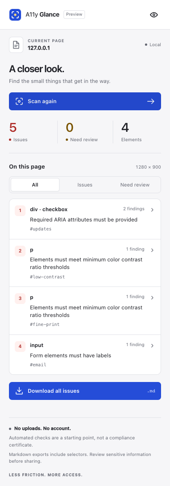
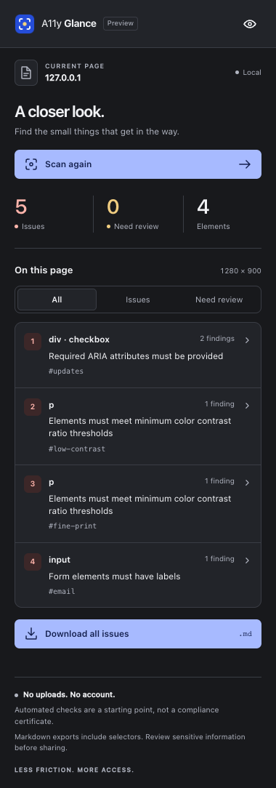

<p align="center"></p>

<h1 align="center">A11y Glance</h1>
<p align="center">Accessibility issues, one glance away.</p>
<p align="center">A small, local-first Chrome extension for finding issues, inspecting elements, and exporting useful Markdown.</p>

Click the toolbar icon. See the issues on the page. Take a focused report back to your code.

A11y Glance is an open-source personal project by [K4pp8](https://github.com/K4pp8). It uses [axe-core](https://github.com/dequelabs/axe-core) for automated checks and concentrates on a quieter inspection workflow: one side panel, grouped elements, and reports you can give to a developer or an AI coding assistant. It does not change your site's colors, write fixes, send content to an AI service, or open a separate audit tab.

**Status: early preview.** Load it locally as an unpacked extension. There is no Chrome Web Store listing yet. See the actual verification record and remaining manual checks in [test.md](test.md).

## A small workspace for a closer look

<p> </p>

Screenshots use a fictional, deliberately inaccessible test page. They are rendered from the extension, not design mockups.

## What it does

- Scans the current rendered page with WCAG 2.2 A/AA rule tags.
- Groups findings by element, so several problems on one button share one marker.
- Separates confirmed automatic issues from findings that need human review.
- Connects page markers and the element list to the same detail view.
- Lets you hide page marks while keeping the report available.
- Downloads Markdown for the full scan, one element, or one individual finding.
- Marks snapshots stale when the page changes; disappearing elements are not treated as verified fixes.
- Follows the system light/dark appearance and reduced-motion preference.

## Install locally

You need Node.js 22.6 or newer, npm, and desktop Google Chrome 116 or newer. Current stable Chrome is recommended; older supported versions are not part of the automated test matrix. Chrome on macOS is the design target, while the extension uses standard web and Chrome APIs.

```sh
git clone https://github.com/K4pp8/a11y-glance.git
cd a11y-glance
npm ci
npm run build
```

1. Open `chrome://extensions` in Chrome.
2. Enable **Developer mode**.
3. Choose **Load unpacked** and select the generated `dist` directory.
4. Pin **A11y Glance** in the extensions menu.
5. Open an ordinary website and click the icon.

The native Chrome side panel opens and the scan starts. Internal Chrome pages, the Web Store, PDFs rendered by Chrome, and other protected documents may not allow injection. File URLs are outside the first-version scope.

After changing the source, run `npm run build`, reload the extension on `chrome://extensions`, and refresh the inspected page. `dist/` is generated and is not committed.

## Everyday use

**Inspect.** Click a numbered marker or an element row. The detail view shows all findings for that element, engine guidance, the locator, and links to rule documentation.

**Export.** Download the entire scan from the list, all findings for the selected element from detail, or just one finding from its own download action. Nothing is uploaded. The report includes URL without query/fragment, viewport, scan time, engine version, scope, selectors, structural snippets, and a suggested verification workflow.

**Rescan.** Open menus, reveal form errors, or move through a user journey, then click **Scan again**. A scan covers that rendered state; it does not crawl the website or exercise hidden interactions.

**Keep context.** Switching tabs changes the panel's context. A new page needs toolbar activation if Chrome has not granted access. Reports live only in the current document's memory, so download what you need before navigating or closing the browser. Closing the panel does not turn off page marks; use the eye button to hide them.

## Privacy and permissions

Analysis runs locally. No telemetry, remote code, remote fonts, account, storage permission, or backend. `axe-core` is packaged with the extension.

| Permission  | Why it exists                                               |
| ----------- | ----------------------------------------------------------- |
| `activeTab` | Temporary access to the page after you invoke the extension |
| `scripting` | Inject the packaged scanner into that page                  |
| `sidePanel` | Keep inspection beside the page, within Chrome's own UI     |

There are no persistent host permissions. A local test harness adds the fixture origin only to a temporary test copy; it never changes the shipping manifest.

Exports omit page text and form values from their structural snippets. This is **not anonymization**: selectors, URL paths, and engine messages can contain identifying information. Review a report before sharing private pages with another person or an AI service. Reports explicitly identify page-derived material as untrusted data.

See [SECURITY.md](SECURITY.md) for the trust boundaries and reporting guidance.

## Scope and limits

Automated checks are a starting point, not a WCAG, EN 301 549, or EAA compliance certificate. Keyboard behavior, screen readers, meaning, full user journeys, and the applicability of legal requirements need separate assessment.

The first version does not scan iframe documents, crawl other URLs, inspect native iOS/Android apps, access closed shadow roots, or map DOM selectors to source files. CSS animation and application updates can make a report stale. Markers are best-effort geometry; the list remains the reliable navigation alternative for dense, hidden, transformed, or unavailable targets.

Chrome desktop is the supported browser. Safari, Firefox, mobile Chrome, and native macOS applications are not supported targets. A macOS-inspired web UI is not an Apple-native application or an Apple endorsement.

## Develop and verify

```sh
npm run check              # strict types, unit tests, production build
npx playwright install chromium
npm run test:browser       # actual extension context with a synthetic local page
npm run format:check
npm run package            # creates release/a11y-glance-0.1.0.zip
```

Browser tests cover actual scan results, grouping, page-to-panel selection, exports, stale and detached nodes, tab changes, light/dark layouts, keyboard focus, and the panel's own accessibility. Read [test.md](test.md) for the distinction between automated evidence and unperformed manual Chrome/macOS checks.

## Project map

```text
src/
  background.ts      Toolbar entry and on-demand injection
  content.ts         Per-document scan state and live element references
  markers.ts         Isolated page outlines and marker placement
  model.ts           Shared types, counts, command validation
  report.ts          Pure Markdown export
  panel/             React side panel, original icons, design tokens
public/              Manifest and panel HTML
assets/              Original editable SVG brand marks
scripts/             Build and distributable packaging
tests/               Unit tests, Chromium flows, fictional fixture
docs/                Architecture and rendered screenshots
design.md            Visual direction and interaction contract
test.md              Acceptance criteria and honest evidence log
```

There is one package, no monorepo, and no application backend. The side panel uses React; the scanner and markers use DOM APIs. Read [architecture.md](docs/architecture.md) before changing the message flow.

## Contribute

Small, reproducible fixes are welcome. Read [CONTRIBUTING.md](CONTRIBUTING.md), [design.md](design.md), and [test.md](test.md). For a new feature, open an issue describing the user task first. The goal is a focused diagnostic tool, not a growing settings application or a second CSS editor.

## License and credits

Original project code and artwork: [MIT](LICENSE). axe-core: MPL-2.0. React and its runtime packages: MIT. Full runtime notices are included in the generated extension; see [THIRD_PARTY_NOTICES.md](THIRD_PARTY_NOTICES.md).

Design references include Apple's Human Interface Guidelines and Chrome's extension UI guidance. The references and decisions are documented in [design.md](design.md). This project is independent of Apple, Google, Microsoft, and Deque.
